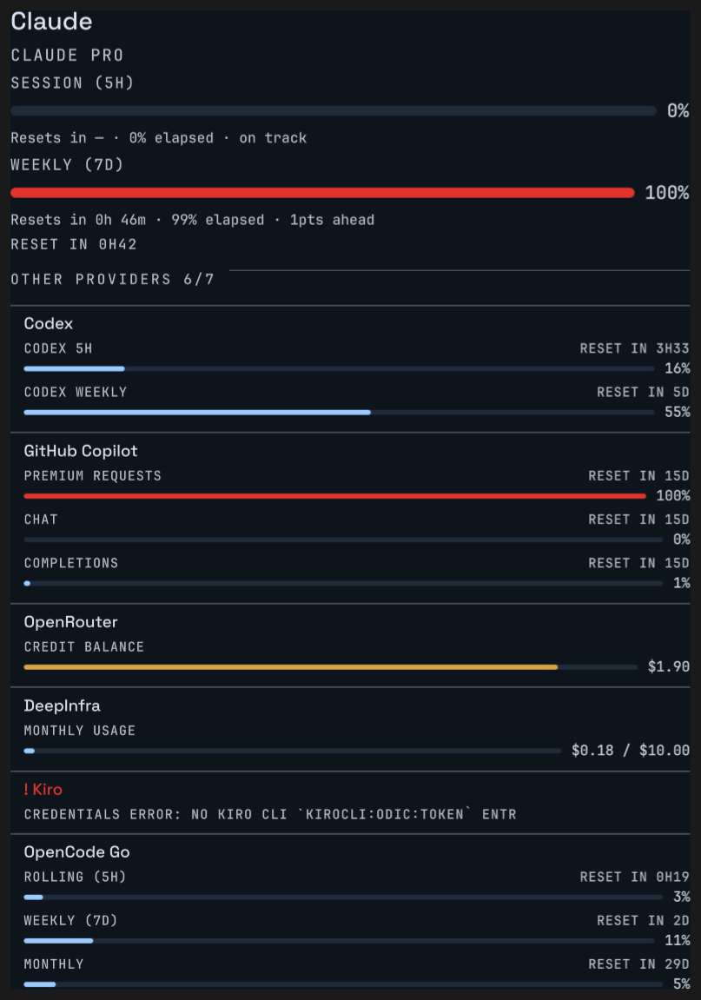

# AI Usage

Your AI plan quotas on the Ryoku desktop, at a glance.

`AI Usage` (`ai-usage`) is a community plugin for the [Ryoku](https://github.com/danmaxis/ryoku-arch)
shell. It reads the local `ai-usagebar` report and shows, for **every** quota of
every provider: how much is used, how much of its time window has elapsed, and
whether you are ahead of or behind the fair share — a vertical tick on each bar
marks elapsed time, so the deviation is visible without reading a number.



## What it shows

- **One line of operational summary** at the top: how many quotas are exhausted,
  how many are above 80%, and when the next reset happens.
- **A meter per quota**, coloured by severity: neutral below 60%, amber from 60
  to 84%, red at 85% and above. The colour reinforces the number; it never
  carries the state alone.
- **Three separate readings per quota** — `Usage`, `Elapsed`, `Pace` — instead of
  one ambiguous sentence. A quota whose window length is unknown shows no pace at
  all, because there is nothing honest to compute.
- **A consolidated view of every enabled provider** with the notable one
  expanded. Providers that share a name but not an account are told apart by the
  account, shown only when the label would otherwise be ambiguous.
- **Compact mode**: one quota per provider, with a per-provider expander and a
  toggle at the top. The toggle is always available, so you can switch between
  compact and expanded from the popout itself; a `Reset view` control appears
  while the popout disagrees with the `Density` setting. The switch is per-open:
  nothing is written to disk.
- **A footer** saying when the data was last read, a refresh button, and how many
  providers have a problem.

## Requirements

`ai-usagebar` must be on your `PATH`. It owns all collection, credentials and
network access; this plugin never talks to a provider itself.

```sh
paru -S ai-usagebar-bin
```

## Install

```sh
ryoku plugin add https://github.com/danmaxis/ryoku-ai-usage-widget
```

Then enable it on the `framePopout` host in **Ryoku Hub → Addons**. Open it from
the frame edge, or bind a key.

### Opening it with a key

In **Ryoku Hub → Keybinds**, bind:

```sh
ryoku-shell plugin ai-usage
```

This is a **toggle**: the same key that opens the popout closes it.

Note: opening directly in compact mode from a keybind is **not possible today** —
the shell accepts an extra argument to `ryoku-shell plugin` and silently ignores
it. That limitation is upstream, not here; see `candidatos/` for the request.

## What it runs, reads and writes

**Runs.** The bundled `bin/ai-usage-collect` script, which invokes exactly one
external program:

```text
ai-usagebar usage --json
```

**Reads.** The local `ai-usagebar` JSON report (schema version 1): provider
names, plans, status, metrics, percentages, reset instants, window lengths and
upstream-provided detail. Key-like fragments inside plan labels are redacted
before they reach the screen.

**Writes.** Nothing. The plugin has no state of its own: no config file, no
cache, no receipt. Its collector is pure stdout. Settings live in Ryoku's own
`plugins.json` and are written by the shell, not by the plugin.

**Network.** None of its own. Whatever `ai-usagebar` does is its own business and
is declared there.

**Commands.** Arguments are always passed as an argv array — never through a
shell (`sh -c`), so a value from settings cannot become a command.

## Settings

| Setting | Options / range | Default | Effect |
| --- | --- | --- | --- |
| Language | Auto, English, Español, Français, Português, Português (BR) | English | UI language. `Auto` follows your session locale. A missing translation falls back to the English string, never to a blank. |
| Accent | Wallpaper, Brand, Monochrome | Wallpaper | Accent token for the neutral band of the meter scale. Amber and red are fixed: a red accent can never make low usage look alarming. |
| Density | Expanded, Compact | Expanded | `Compact` shows one quota per provider with an expander. |
| Provider order | Upstream primary, Highest headline %, Lowest headline %, Alphabetical, Manual sequence | Upstream primary | Which provider gets the expanded card, and the list order. |
| Manual sequence | comma-separated ids | *(empty)* | With `Manual sequence`: ids in the order you want, e.g. `anthropic,openai@work`. The first ready one is expanded. |
| Pinned provider | a report id | *(empty)* | Forces one provider into the expanded card in any order mode. A pinned provider that is in error does not get the card — the next healthy one does, and the pinned one is still listed. |
| Show primary pace detail | On / Off | On | Shows the derived `Elapsed` and `Pace` lines. Never hides `Usage`, which is the datum the plugin exists to show. |
| Secondary label | Name, Short code, Plan | Name | Label used for secondary providers. |
| Show secondary row | On / Off | On | Shows or hides the secondary list. |
| Sec. rows | 0–12 | 6 | How many secondary providers the detail shows. |
| Padding | 0–32 | 12 | Inner spacing. |
| Row gap | 2–24 | 6 | Spacing between sections. |
| Every (s) | 60–3600 | 300 | Report polling interval. The upstream caches, so aggressive polling is waste. |
| Keybind | *(free text)* | *(empty)* | Reminder of the command to bind. Display only — the shell verifies nothing typed here. |

Ordering never recomputes the upstream's numbers: it sorts by the percentage each
provider reports and keeps providers with a usable percentage ahead of ones in
error or without metrics; ties keep report order.

## Honest limitations

- **The popout is not transparent.** The background belongs to the host shell,
  not to the plugin, and there is no plugin-side way to change it. A request is
  filed upstream.
- **`0%` and "no data" are different things, on purpose.** A quota at 0% draws an
  empty bar and says `0%`. A quota without a percentage draws no bar at all and
  says `—`.
- **"Exhausted" and "above 80%" are absolute thresholds**, not pace-aware. A
  quota at 89% of a window that is already 80% elapsed is painted red, even though
  the upstream's own severity field calls it merely high — the upstream weighs
  elapsed time, this plugin's summary does not. Colour follows the percentage.
- **Opening in compact mode from a keybind is not possible** (see above).
- **The compact/expanded switch is per-open.** A button drawn by the plugin
  cannot persist the `Density` setting: the frame popout host gives the view an
  API without `saveSetting`, only a no-op `saveSettings`. Use the `Density`
  setting for a lasting choice; the top toggle changes the current view only.
- **Expansion state is not remembered** between openings, for the same reason.
- **The timer stops when the popout is closed.** Countdowns and the "updated N ago"
  line tick only while the surface exists. Reopening re-reads the report — the
  view asks for a refresh on mount when the data is older than 30 seconds.

## Languages

English is the source of truth: UI strings are the English text itself, so an
untagged string is never broken. Translations ship for Español, Français,
Português and Português (BR). Adding a language means adding
`content/i18n/<code>.json` with the same keys — anything untranslated falls back
to English.

Translations live in the plugin because a plugin may not import the shell's own
i18n module (R4) and may not read `shell.json` (R5). The language is chosen by the
setting above, not by the shell's global language.

## Development

The plugin is self-contained and follows the same rules `ryoku plugin validate`
enforces — see `AGENTS.md` in this folder for the short list and
`docs/plugins.md` upstream for the long one.

```sh
ryoku plugin validate .
python -m pytest tests/ -q          # 446 passed, 1 skipped
```

Tests live in `tests/` inside the plugin folder: behavioural harnesses that mount
the real view in an offline `quickshell`, plus unit tests for the pure functions
(the reset-time formatter, the colour scale, the summary arithmetic).

## Privacy

This is a community plugin (`official: false`). It contains no account data, no
credentials and no compiled binaries. It reads one local JSON report and writes
nothing.

## License

MIT — see `LICENSE`.

## Author

Danilo Heroso <danmaxis@gmail.com>
